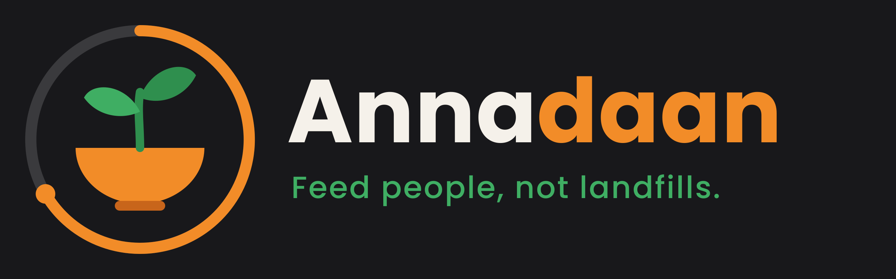

# Annadaan — Feed people, not landfills

**Annadaan connects surplus food from caterers in Bhubaneswar to nearby NGOs, community kitchens and volunteers before it spoils.** A caterer posts in under a minute, AI reads their description, rules match the food to the right receiver, and every rescue shows its real impact.

Built for the **Codebenders ACE Builders' Hackathon 2026 — Problem Statement 2: Society and Environment ("Rescue the Surplus")**.

- **Live demo:** https://annadaan-three.vercel.app/
- **Product requirements (PRD v1.5):** [Annadaan-PRD.md](Annadaan-PRD.md)

*Annadaan* means "gift of food". Annadaan connects people; it does not certify that food is safe.

---

## Try the demo in 2 minutes

All data is synthetic. Use the role buttons at the top to switch between people. **Reset demo** restores the starting data.

1. **Donor** — type a description such as `40 plate chicken biryani au 5 litre kheer, ready at 6:30 pm, pickup by 11 pm, hot` and press **Fill with AI**. Check the AI-filled fields, enter the total kg, and press **Post listing**. Try *Demo Caterer 15* to see an unlicensed donor blocked.
2. **Receiver** — the listing is offered to the best-matching receiver, with the reason it was chosen. **Accept** it (or **Decline** to pass it to the next match).
3. **Volunteer** — enter the 4-digit handover code shown in the Donor view. A wrong code is rejected.
4. **Receiver** — confirm the kg received to mark it **Delivered**.
5. **Sponsor** — see food waste avoided (kg), meals saved and deliveries, with the assumptions behind each number.

## What it does

| Brief requirement | How Annadaan meets it |
| --- | --- |
| Donor flow under a minute | Three-field form, or a free-text description read by AI and confirmed by the donor |
| Smart matching | Rules filter receivers by registration, distance, capacity, time left and dietary conflicts, then rank them with a plain reason |
| Pickup coordination with live status | Posted → Offered → Claimed → Collected (handover code) → Delivered, plus Expired |
| Impact view with assumptions | Delivered kg, meals (0.4 kg per meal) and deliveries; only delivered food is counted |
| Handling and safety information | Every listing shows storage, a consume-by deadline, allergens and the disclaimer |

## Food safety and guardrails

- **FSSAI-verified donors and receivers only.** Unlicensed or expired donors cannot post; unregistered receivers are never matched (synthetic licence numbers and a mocked check in the demo).
- **Consume-by deadline** = the earlier of the pickup time and a conservative storage limit counted from the cooking time. Listings under 30 minutes from their deadline are not offered.
- **Never certified safe.** Every listing shows "Not certified safe — follow handling guidance." No text promises tax or legal benefits.
- **Allergens are never assumed absent.** Empty means "unknown — ask donor".
- **Synthetic data only.** Zones instead of addresses; no real people.

## How the AI is used, and checked

- **What AI does:** reads a donor's free-text post (including Odia–English) into items, quantities, times, storage and allergens. Model: `qwen/qwen3.8-27b` on Groq, with `openai/gpt-oss-120b` as fallback, called from a server function so the API key never reaches the browser.
- **What AI never does:** decide safety, deadlines, matching or impact numbers. Those are plain, tested code.
- **When AI is wrong:** the donor sees every AI-filled field labelled "AI-filled — check" and must confirm before posting. Times are clock-only, must match the donor's own words, and today's date is added in code. A food-to-allergen map in code adds allergens the AI misses (paneer, kheer → milk) and never removes one. If the AI is unavailable, the plain form still works.
- **Golden dataset:** 22 hand-checked cases, including Odia–English posts, implicit allergens and prompt-injection attempts. Run on the first 20 cases, Nov 22, 2026: **100% field accuracy, 3/3 allergens caught, 0 invented values, 2/2 injection attempts ignored.**

## Tech stack

Vite + React + TypeScript · rules in plain TypeScript modules · state in the browser (localStorage) · one Vercel serverless function (`api/parse`) · Groq free tier · Vitest (84 unit tests) · hosted on Vercel.

## Run it locally

```bash
npm install
npm run dev          # app at http://localhost:5173 (AI fill needs the Vercel function; test it on the live site)
npm test             # unit tests, no API key needed
npm run build
npm run eval         # golden-set AI eval; needs GROQ_API_KEY in .env; takes a few minutes
```

Copy `.env.example` to `.env` and add your own `GROQ_API_KEY` to run the eval. Never commit `.env`.

## What's next

Deliberately deferred from the MVP (see the PRD for the reasons): automatic timers for expiry, offer timeouts and escalation; notifications; a database (Supabase); live FSSAI portal lookup; Llama Prompt Guard as a second injection screen; donor weekly reports. Roadmap: validation with Bhubaneswar caterers and NGOs, a 4-week closed pilot, and a proposed city launch on Feb 15, 2027.

## Project structure

- `src/` — app and rules (`src/lib`: rules, matching, lifecycle, store, impact, intake, allergen map)
- `api/parse.ts` — server function for AI parsing
- `tests/` — unit tests, golden dataset (`tests/golden/intake.json`) and eval script
- `Annadaan-PRD.md` — product requirements document (source of truth)
- `.codebenders/` — brand assets and phase specs from spec-driven development

See also [CONTRIBUTING.md](CONTRIBUTING.md), [CHANGELOG.md](CHANGELOG.md) and [SECURITY.md](SECURITY.md).

## Author

Soumya — product owner, developer, tester and deployer (one-person team).

## License

Code: Apache-2.0 ([LICENSE](LICENSE)). The Annadaan name and logo are not covered by the licence.
